# LeadZam Click-to-Call

LeadZam is a local internship-assessment project that connects a small CRM dashboard to an Android application through Firebase Cloud Messaging. A CRM user selects a mock lead and requests a call; the Android user receives the request and can open the native dialer with the number prefilled.

## Architecture and request flow

```text
React CRM dashboard
  -> GET /api/devices and select a friendly device name
  -> POST /api/dial { phoneNumber, contactName, optional deviceId }
  -> Express validation and unique request ID
  -> Firebase Admin SDK / data-only high-priority FCM
  -> MyFirebaseMessagingService on Android
  -> received acknowledgement and call-request notification
  -> user taps Call or explicit Dismiss
  -> Android acknowledges dialer_opened or dismissed
  -> Android ACTION_DIAL opens the native dialer when Call succeeds
  -> dashboard polls GET /api/requests for confirmed backend status and device name
```

When the Android app starts or receives a refreshed FCM token, it sends its stable device ID, friendly name, and current token to `POST /api/devices/register`. The backend keeps the token private and returns only safe device metadata to the dashboard.

`accepted` means Firebase accepted the message for sending. `received` means Android processed the request. `dialer_opened` means Android successfully launched the native dialer. `dismissed` means the user explicitly selected Dismiss. No status claims that a phone call was completed.

### Component architecture and return paths

```mermaid
flowchart LR
    CRM[React CRM dashboard<br/>lead selection<br/>device selection<br/>Call action]
    Poll[Dashboard polling<br/>GET /api/requests]

    subgraph API[Node.js / Express backend]
        Validate[Request validation]
        Idempotency[clientRequestId<br/>idempotency guard]
        Devices[In-memory device registry<br/>deviceId + friendly name + token]
        History[In-memory request history<br/>requestId + status]
        Ack[POST /api/requests/:requestId/ack<br/>validated transitions]
        Firebase[Firebase Admin SDK sender]
        Fallback[Legacy FCM_TOKEN<br/>when no device is registered]
    end

    FCM[Firebase Cloud Messaging<br/>data-only dial_request]

    subgraph Android[Kotlin Android app]
        Identity[Stable device identity<br/>friendly-name registration]
        Service[FirebaseMessagingService<br/>parse and process request]
        Notification[Request notification<br/>explicit Call / Dismiss actions]
        AckClient[Acknowledgement client]
    end

    Dialer[Native Android dialer<br/>ACTION_DIAL only]

    Identity -->|POST /api/devices/register<br/>current registration token| Devices
    CRM -->|POST /api/dial<br/>phoneNumber, contactName,<br/>deviceId, clientRequestId| Validate
    Validate --> Idempotency
    Idempotency --> Devices
    Idempotency --> History
    Devices -->|selected device token| Firebase
    Fallback -.->|no registered devices| Firebase
    Firebase -->|server-side send| FCM
    FCM -->|type=dial_request,<br/>requestId, phoneNumber, contactName| Service
    Service --> Notification
    Service -->|received acknowledgement| AckClient
    Notification -->|user chooses Call| Dialer
    Notification -->|user chooses explicit Dismiss| AckClient
    Dialer -->|successful launch| AckClient
    AckClient -->|POST ack: received,<br/>dialer_opened, dismissed, or failed| Ack
    Ack --> History
    History -->|confirmed status and history| Poll
    Poll -->|periodic GET /api/requests| History
    Devices -->|safe device names and availability| CRM
    History -->|request status and device name| CRM

    classDef dashboard fill:#e8f1ff,stroke:#3167b1,color:#102a43;
    classDef backend fill:#eef8ee,stroke:#39824b,color:#17351d;
    classDef android fill:#fff4df,stroke:#bd7a13,color:#4a2d00;
    classDef external fill:#f1eaff,stroke:#7653b8,color:#28164f;

    class CRM,Poll dashboard;
    class Validate,Idempotency,Devices,History,Ack,Firebase,Fallback backend;
    class Identity,Service,Notification,AckClient,Dialer android;
    class FCM external;
```



Device registrations and request history are intentionally in memory and reset when the backend restarts. `accepted` only confirms Firebase accepted the message for sending; it does not guarantee Android delivery. `ACTION_DIAL` opens the dialer with a prefilled number after the user chooses Call and never places the call automatically.

## Repository structure

- `backend/` — Express API, Firebase Admin sender, environment example, and Node tests. See [backend/README.md](backend/README.md).
- `web-dashboard/` — React, Vite, and TypeScript CRM dashboard. See [web-dashboard/README.md](web-dashboard/README.md).
- `android-app/` — Kotlin/Jetpack Compose Android app, FCM service, device registration/name UI, notifications, token display, and dialer flow.
- `AI_USAGE_LOG.md` — canonical record of AI-assisted work, tests, and limitations.

## Prerequisites

The repository includes an Android Gradle wrapper, so a system Gradle installation is not required.

- Node.js and npm. The documented verification environment used Node `v24.18.1` and npm `11.16.0`.
- Android Studio with an Android SDK, an emulator or Android device with Google Play services, and a JDK compatible with the Android toolchain.
- Discovered Android project versions: Gradle wrapper `9.6.0`, Android Gradle Plugin `9.4.1`, Kotlin `2.2.10`, compile/target SDK `37`, and minimum SDK `24`. Java source/target compatibility is `11`; the recorded Gradle verification used JDK 21.
- A Firebase project with Android app package `com.example.leadzam` for device testing.

## Firebase and environment setup

Never place Firebase Admin credentials, FCM registration tokens, or private keys in source control.

### Android Firebase configuration

1. In Firebase Console, register the Android app with package name `com.example.leadzam`.
2. Download that app's `google-services.json` and place it at `android-app/app/google-services.json`. This local file is ignored by the repository security rules.
3. Build and install the app using the Android commands below.
4. Launch the app and grant notification permission on Android 13 or later.
5. Copy the FCM registration token shown by the app.

### Backend configuration

From `backend/`, create a local `.env` from `.env.example` and replace only the placeholders:

```powershell
cd D:\Projects\LeadZam\backend
Copy-Item .env.example .env
```

Required variables:

```text
GOOGLE_APPLICATION_CREDENTIALS=C:\secure\firebase\leadzam-service-account.json
FCM_TOKEN=the-current-token-copied-from-the-Android-app
```

`GOOGLE_APPLICATION_CREDENTIALS` must point to a Firebase Admin service-account JSON file stored outside this repository. `FCM_TOKEN` remains the legacy single-device fallback. The Android app registers its current token and friendly name with the running backend when its configured backend URL is reachable. Optional variables are `PORT` (default `3000`) and `CORS_ORIGIN` (comma-separated allowed origins; defaults to `http://localhost:5173,http://127.0.0.1:5173`).

### Dashboard configuration

From `web-dashboard/`, create `.env` from the example:

```powershell
cd D:\Projects\LeadZam\web-dashboard
Copy-Item .env.example .env
```

Set `VITE_API_BASE_URL` to the backend origin, normally:

```text
VITE_API_BASE_URL=http://localhost:3000
```

The dashboard contains no Firebase credentials or FCM tokens.

## Run the components

Install dependencies once in each Node component:

```powershell
cd D:\Projects\LeadZam\backend
npm install

cd D:\Projects\LeadZam\web-dashboard
npm install
```

Run the backend and dashboard in separate PowerShell windows:

```powershell
# Window 1
cd D:\Projects\LeadZam\backend
npm start

# Window 2
cd D:\Projects\LeadZam\web-dashboard
npm run dev
```

The backend listens on `http://localhost:3000` by default. Vite normally serves the dashboard at `http://localhost:5173`.

Build/install the Android app from a third window:

```powershell
cd D:\Projects\LeadZam\android-app
.\gradlew.bat app:assembleDebug
.\gradlew.bat app:installDebug
```

`app:installDebug` requires a connected device or running emulator. Open the installed `LeadZam` app, set a friendly device name, and keep the app pointed at the running backend. The app registers its current token automatically. The existing local `FCM_TOKEN` fallback can still be used when no registered device is available.

### Windows Android build troubleshooting

Before running the Android Gradle commands, verify that Windows can launch Java:

```powershell
java -version
$env:JAVA_HOME
where.exe java
```

If `java -version` fails or `JAVA_HOME` points to an invalid installation, open Android Studio and check the configured Gradle JDK at **Settings → Build, Execution, Deployment → Build Tools → Gradle → Gradle JDK**. Select an appropriate already-installed JDK compatible with the Android toolchain, then restart the terminal or Android Studio as needed. Do not change the Gradle or Kotlin versions just to work around a local JDK selection problem.

In the current verification environment, `java -version` exits with code `-1073740791`, so Gradle cannot start. Android build, unit-test, and connected-test verification of the Point 5 changes is therefore outstanding until a working JDK and `JAVA_HOME`/`PATH` configuration are available. No Android or live FCM success is claimed from this environment.

## API

### `GET /health`

Returns HTTP `200` without exposing credential values:

```json
{
  "status": "ok",
  "service": "leadzam-backend",
  "firebase": {
    "credentialsConfigured": true,
    "tokenConfigured": true
  }
}
```

The two Firebase fields are booleans indicating whether the corresponding environment variables are present, not whether a live send has succeeded.

### `POST /api/dial`

Request body:

```json
{
  "phoneNumber": "+91 98765 43210",
  "contactName": "Rahul Sharma",
  "deviceId": "optional-registered-device-id",
  "clientRequestId": "dashboard-attempt-123"
}
```

`phoneNumber` is required, must contain 7–15 digits, may use a leading `+`, spaces, hyphens, and parentheses, and must be 7–20 characters after trimming. `contactName` is optional, defaults to `Unknown Contact` when absent or blank, and must be at most 100 characters. `deviceId` is optional and must identify a registered device when supplied. `clientRequestId` is an optional dashboard retry key containing 1–100 letters, numbers, hyphens, or underscores. Reusing the same key rechecks an existing request instead of sending another FCM message; it cannot be reused for a different device.

On success, the backend returns HTTP `200` with `success: true`, the message `FCM message accepted by Firebase.`, a Firebase message ID, a unique `requestId`, `status: "accepted"`, and safe target-device metadata. The sent FCM message is data-only and contains `type=dial_request`, `requestId`, `phoneNumber`, and `contactName`, with Android priority `high`.

Important responses implemented by the backend:

- `400 invalid_request` — invalid body, missing/invalid phone number, or invalid contact name.
- `400 invalid_json` — malformed JSON.
- `403 cors_origin_not_allowed` — browser origin is not in `CORS_ORIGIN`.
- `413 request_too_large` — request body exceeds 32 KB.
- `404 device_not_found` — the requested device ID is not registered with this backend.
- `410 device_unavailable` — the selected device is unavailable or its FCM token is stale.
- `503 firebase_not_configured` — required configuration is missing or the service-account file is invalid/unavailable.
- `502 fcm_send_failed` — Firebase did not accept the send request. The response includes safe `retryable` and `ambiguous` flags; an ambiguous result should be retried with the same `clientRequestId` to check status, not silently sent to another device.
- `500 internal_server_error` — unexpected backend failure.

### `POST /api/devices/register`

The Android app uses this endpoint to register a stable device ID, friendly name, and current FCM registration token. The response contains only safe device metadata; registration tokens are never returned to the dashboard or from `GET /api/devices`.

### `GET /api/devices`

Returns registered device names, availability, timestamps, and the in-memory default device ID. It never returns FCM registration tokens. If there are no registered devices, calls without `deviceId` use the legacy `FCM_TOKEN` fallback.

### `GET /api/requests`

Returns the latest in-memory request records and a count. Records contain the request ID, contact details, selected device name/ID, status, and timestamps; Firebase credentials and FCM registration tokens are never returned. The history is limited and resets when the backend restarts.

### `POST /api/requests/:requestId/ack`

Request body:

```json
{
  "status": "received"
}
```

Allowed Android statuses are `received`, `dialer_opened`, `dismissed`, and `failed`. The backend accepts only known request IDs and valid transitions, rejects stale or out-of-order events, and treats duplicate acknowledgements of the current status as idempotent. Swiping a notification away does not acknowledge `dismissed`; only the explicit Dismiss action does.

## Testing and verification

Backend tests:

```powershell
cd D:\Projects\LeadZam\backend
npm test
```

Dashboard checks:

```powershell
cd D:\Projects\LeadZam\web-dashboard
npm run typecheck
npm run build
npm run lint
```

Android checks:

```powershell
cd D:\Projects\LeadZam\android-app
.\gradlew.bat app:testDebugUnitTest
.\gradlew.bat app:connectedDebugAndroidTest
```

The first Android command is host-side unit testing; the connected test requires a device/emulator. The Android app's local acknowledgement URL defaults to `http://10.0.2.2:3000` for an emulator. For a physical device, pass a reachable host URL with `-PleadzamBackendUrl=http://<host-lan-address>:3000` when building. Live Firebase delivery, notification actions, acknowledgements, and dialer behavior still require manual device verification.

## Manual end-to-end test

1. Configure Firebase, start the backend, install the Android app, and grant notification permission.
2. Set a friendly device name in the Android app. Confirm the app can reach the backend so it can register its current token; otherwise configure the legacy `FCM_TOKEN` fallback in `backend/.env`.
3. Configure `web-dashboard/.env` with the backend URL; start Vite.
4. Select the friendly Android device in the dashboard, then click a lead's `Call` button. Confirm the dashboard first shows `Accepted`, then `Received` after Android processes the request. Select the in-app `Call` button and confirm `Dialer opened`; select `Dismiss` for a separate request and confirm `Dismissed`.
5. Put the Android app in the background and repeat the dashboard request. Confirm a request-specific notification appears. Tapping its explicit `Call` action should launch `ACTION_DIAL`; tapping its explicit `Dismiss` action should acknowledge `dismissed`. Swiping the notification away should not report dismissal.
6. Confirm the dashboard history updates through polling. Do not interpret `accepted` as device receipt or any status as a completed phone call.

## Known limitations

- The dashboard uses mock leads; there is no database, authentication, or real CRM integration.
- The backend is a local assessment service with no production authentication, rate limiting, or deployment configuration.
- Request history is intentionally in-memory and resets when the backend restarts.
- Device registrations and token associations are intentionally in-memory and reset when the backend restarts. The local registration endpoint has no authentication and is not production infrastructure.
- Android registration and acknowledgement transport retries at most once for transient network/HTTP failures. Permanent validation and unavailable-device responses are not retried. Failed acknowledgements are logged and do not relaunch the dialer.
- The final live Point 2 send check was blocked by the local `FCM_TOKEN` being rejected as `messaging/registration-token-not-registered`; copy the current Android token into the local backend `.env` before repeating the manual flow.
- FCM registration tokens can rotate and must be refreshed in the backend environment.
- Android notification delivery, background behavior, and dialer behavior require a compatible device/emulator and appropriate notification permission.
- `npm audit --omit=dev` currently reports 8 moderate transitive vulnerabilities in the backend Firebase Admin dependency tree. The suggested forced fix is a breaking `firebase-admin` upgrade and was not applied during this review; the dashboard audit reports 0 vulnerabilities.
- The repository's current Git history already contains generated dependency/build content from earlier work; the security review does not rewrite history or remove tracked files. See the AI usage log and final Phase 7 report for the exact finding.

## AI Usage Notes

1. **Was AI used?** Yes. OpenAI Codex was used as an implementation and review assistant in the local repository workspace.
2. **What did AI assist with?** It assisted with the Android FCM/token/notification, acknowledgement, request-history, and dialer flow, the Express/Firebase Admin backend, the React dashboard, troubleshooting, documentation, and credential/Git hygiene review. The detailed prompts, files, decisions, and limitations are recorded in [AI_USAGE_LOG.md](AI_USAGE_LOG.md).
3. **What was reviewed or tested?** Point 2 backend tests, dashboard typecheck/build/lint, Android debug build/unit tests, and connected Android tests were run successfully. Live notification actions, acknowledgement delivery, and dialer behavior still require manual device confirmation.
4. **What remains limited or unverified?** The dashboard uses mock leads, the backend is local and unauthenticated, device registrations and request history are in-memory, Firebase credentials remain local-only, and a fresh manual dashboard-to-Android registration, acknowledgement, and dialer flow must be recorded separately.
